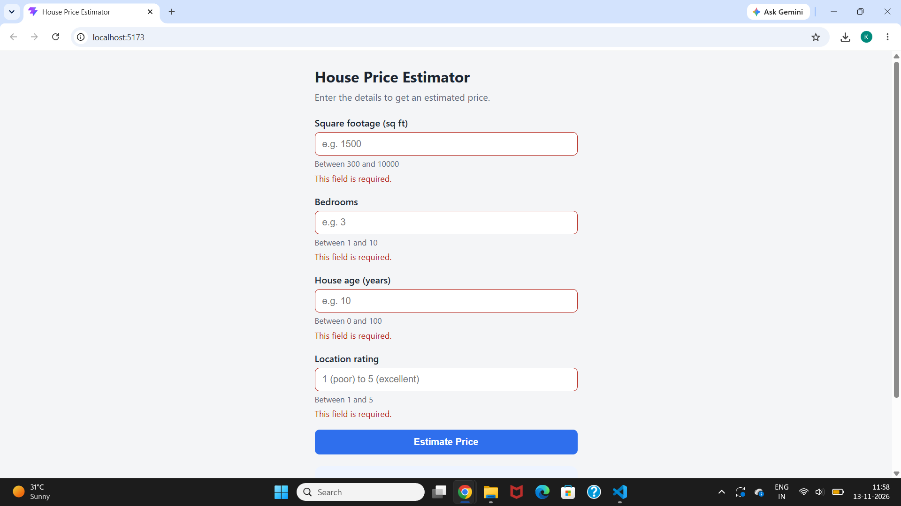
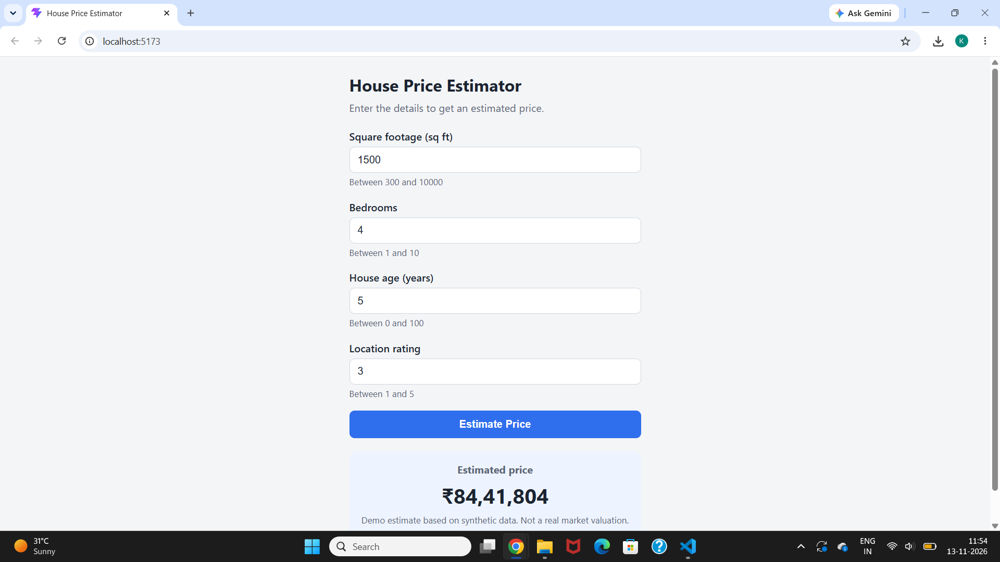
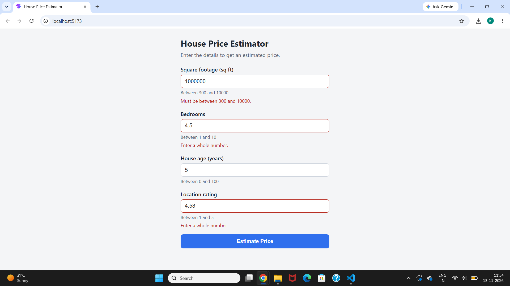
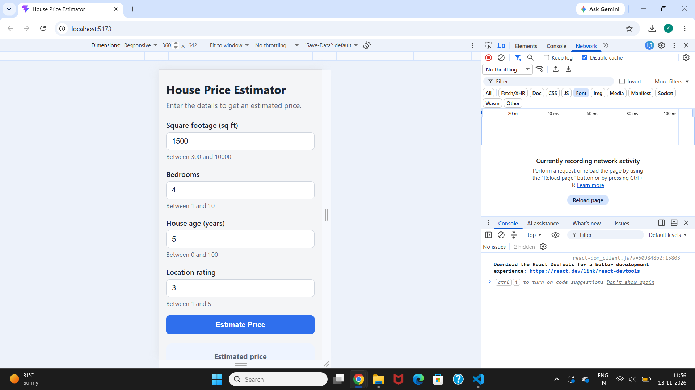
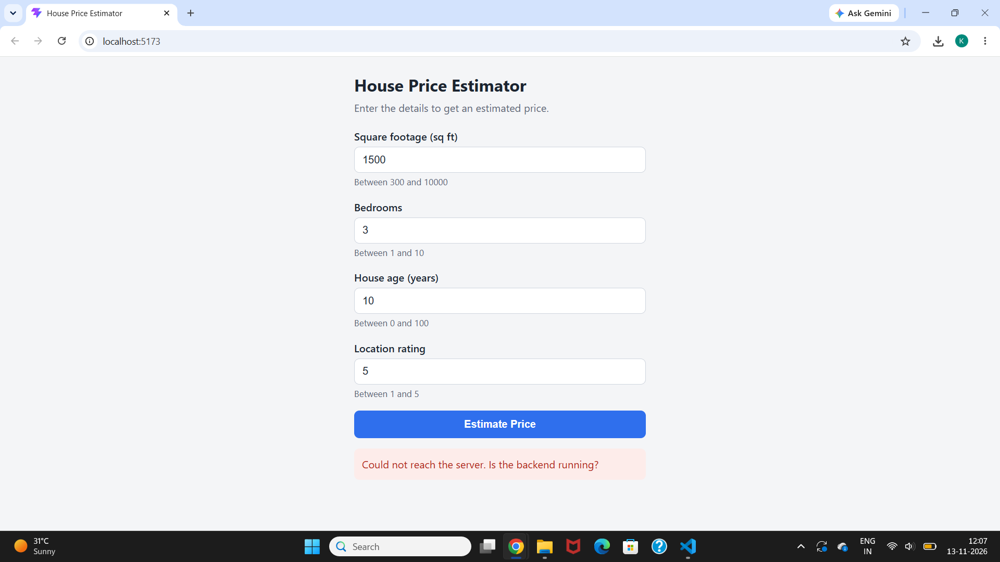

# House Price Estimator

A full-stack machine-learning web app: enter a house's size, bedrooms, age and location rating, and get an instant price estimate in INR.

**Stack:** React (Vite) · Django + Django REST Framework · scikit-learn

> **Note:** The model is trained on synthetic data. The output is a demo estimate for a learning project, not a real market valuation.

## Screenshots

| Empty form | Estimate result |
|---|---|
|  |  |

| Validation error | Mobile (360px) |
|---|---|
|  |  |

| Backend Stopped |
|---|
|  |

## Features

- Single-page form with four inputs: square footage, bedrooms, house age, location rating
- Validation in the browser (instant hints) and again on the server
- Estimates formatted in INR with Indian digit grouping (e.g. ₹86,89,890)
- Loading, field-error and server-unreachable states
- Responsive layout, labelled inputs, light and dark mode
- Stateless API with the model loaded once at startup
- Automated tests for the model, the API and the UI

## How it works

```
React form  --POST /api/v1/estimate/-->  Django + DRF  -->  house_model.pkl  -->  { "estimated_price": 8689889.57 }
 (port 5173)        JSON                 (port 8000)       (scikit-learn)
```

1. React validates the inputs and sends them as JSON with Axios.
2. Django validates type and range with a DRF serializer.
3. The pre-loaded model predicts a price.
4. React displays it formatted as INR.

## API

`POST /api/v1/estimate/`

```bash
curl -X POST http://localhost:8000/api/v1/estimate/ \
  -H "Content-Type: application/json" \
  -d '{"sqft":1500,"bedrooms":3,"age":10,"location_rating":4}'
```

```json
{ "estimated_price": 8689889.57 }
```

| Field | Type | Range |
|---|---|---|
| `sqft` | number | 300 to 10,000 |
| `bedrooms` | integer | 1 to 10 |
| `age` | number | 0 to 100 |
| `location_rating` | integer | 1 to 5 |

Invalid input returns `400` with per-field messages. Full details: [API specification](docs/06-api-spec.md).

## Model

Trained on 2,000 synthetic rows (seed 42). LinearRegression and RandomForest were compared on a 20% test set and LinearRegression was selected.

| Model | R² | MAE (₹) | RMSE (₹) |
|---|---|---|---|
| **LinearRegression** (selected) | 0.9982 | 3,27,651 | 4,13,394 |
| RandomForestRegressor | 0.9958 | 5,13,560 | 6,39,392 |

Details: [ML dataset and model](docs/07-ml-model.md).

## Repository layout

```
house-price-estimator/
├── backend/       # Django + DRF API
├── frontend/      # React + Vite app
├── ml_model/      # train.py, tests, house_model.pkl, metrics
├── docs/          # project documents and screenshots
├── scripts/       # GitHub setup helper
└── .github/       # PR and issue templates
```

## Getting started

**Prerequisites:** Python 3.11+, Node.js 20+, Git.

### 1. Clone and create a virtual environment

```bash
git clone https://github.com/KhushiMulchandani/house-price-estimator.git
cd house-price-estimator
python -m venv venv
venv\Scripts\activate          # macOS/Linux: source venv/bin/activate
```

### 2. Run the backend

```bash
pip install -r backend/requirements.txt
cd backend
copy .env.example .env         # macOS/Linux: cp .env.example .env
python manage.py runserver     # http://localhost:8000
```

The trained model `ml_model/house_model.pkl` is included in the repository, so no training is needed to run the app.

### 3. Run the frontend (second terminal)

```bash
cd frontend
copy .env.example .env         # macOS/Linux: cp .env.example .env
npm install
npm run dev                    # http://localhost:5173
```

### 4. Optional: retrain the model

```bash
pip install -r ml_model/requirements.txt
cd ml_model
python train.py
```

This overwrites `house_model.pkl` and `model_metrics.json`. The scikit-learn version is pinned because a pickle can fail to load under a different version.

## Running the tests

```bash
cd backend && python manage.py test        # API tests
cd frontend && npm test                    # UI tests
cd ml_model && pytest                      # model tests (needs ml_model/requirements.txt)
```

## Documentation

| # | Document |
|---|---|
| 1 | [Project overview](docs/01-project-overview.md) |
| 2 | [SRS and features](docs/02-srs.md) |
| 3 | [System architecture](docs/03-architecture.md) |
| 4 | [Database design](docs/04-database-design.md) |
| 5 | [UI/UX and flows](docs/05-ui-ux.md) |
| 6 | [API specification](docs/06-api-spec.md) |
| 7 | [ML dataset and model](docs/07-ml-model.md) |
| 8 | [Project plan](docs/08-project-plan.md) |
| 9 | [Testing and security](docs/09-testing-security.md) |

## Development workflow

Short-lived feature branches, Conventional Commits, and a pull request for every change, tracked with GitHub milestones and issues. See [CONTRIBUTING.md](CONTRIBUTING.md).

## Limitations

- Prices come from a model trained on synthetic data and are not real valuations.
- The API is stateless: nothing is saved between requests.
- Inputs outside the documented ranges are rejected.

## Next project

**BitVision**: a Bitcoin price predictor built on the same stack, with live data and time-series models.

## License

MIT. Add a `LICENSE` file before publishing.
